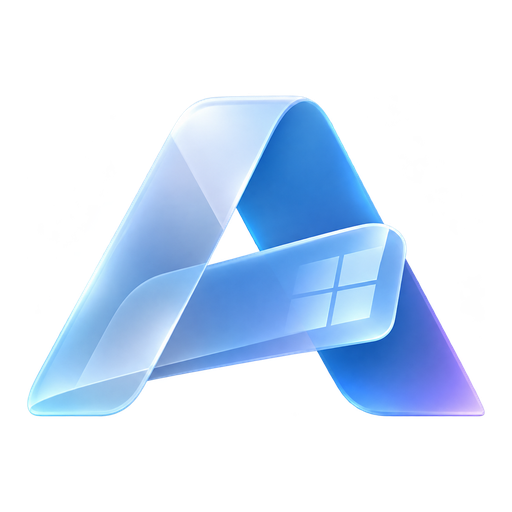
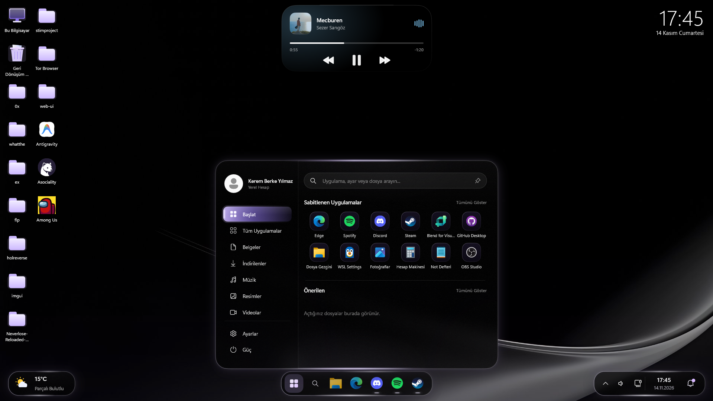

<p align="center"></p>

# Aether

**A complete native Windows desktop shell: Dynamic Island, taskbar, Start menu, flyouts, desktop widgets, desktop, file manager, Recycle Bin and a real installer. Written in C++20 with Direct2D and DirectComposition. No Electron, no web views.**


[Turkish / Türkçe](README.tr.md)

## Showcase



Aether is a set of small programs that share one look. Use them next to Windows, or let Aether **replace Explorer as the shell** completely.

| Program | What it is | Admin |
| :--- | :--- | :---: |
| `Aether.exe` | Dynamic Island, desktop widgets, Settings Center | no |
| `AetherBar.exe` | Taskbar: dock, Start menu, tray host, flyouts | yes (UAC) |
| `AetherDesktop.exe` | Desktop: wallpaper, icons, customisation window | no |
| `AetherExplorer.exe` | File manager | no |
| `AetherBin.exe` | Recycle Bin window | no |
| `AetherShell.exe` | Session manager: starts and supervises the others, Alt+Tab, Win+R, Win+M ... | no |
| `AetherIntro.exe` | Greeting animation shown at logon / first run | no |
| `AetherSetup.exe` | Single-file installer / uninstaller | yes |

---

## Features

### Dynamic Island
- Spring-physics pill at the top of the screen that morphs between idle, media, system, volume and notification states.
- Live media control (Spotify, browsers, any player that uses Windows media controls): album art, progress, transport buttons, volume HUD.

### Taskbar (AetherBar)
- Multi-monitor dock with running and pinned apps and a show-desktop edge (handled by AetherDesktop when it is running).
- Custom **Start menu** with search, pinned and recent apps, user card and power menu.
- Real **system tray host**, crisp icons at native size.
- Own animated flyouts: quick settings, network centre (Wi-Fi with WPA2/WPA3), notification centre, weather ([Open-Meteo](https://open-meteo.com/)), calendar.

### Desktop (AetherDesktop)
- Draws the wallpaper (fill / fit / stretch / center / tile, cross-fade) and the desktop icons in the Aether glass style, directly above Windows' own desktop. Closing it simply uncovers Explorer's desktop again.
- Select, marquee, drag & drop (move on the grid, into folders and the bin, to and from other windows), rename, copy / cut / paste, delete, open, keyboard navigation, real Windows context menu behind "More options".
- Free placement on a snapping grid or auto arrange, real shell icons and thumbnails loaded in the background, `Ctrl` + mouse wheel resizes the icons.
- **Customise** window (right-click the desktop): live preview, wallpaper and slideshow, dim, blur, icon size, labels, glow, accent colour, clock. It opens in its own top-most window, above the widgets.
- `Win` + `D` shows the desktop; the taskbar button does the same.

### Desktop widgets
Draggable, grid-snapping cards: System performance, Network activity, Clock, Storage, Weather, Now playing. Right-click a widget to hide it (or all widgets).

### File manager (AetherExplorer) and Recycle Bin (AetherBin)
- From-scratch file manager: virtualised list, background directory listing and file operations, 0 % CPU while idle.
- Archives through 7-Zip / WinRAR / Windows' `tar.exe`, network locations, the genuine Windows context menu where needed.
- Recycle Bin window: original folder, delete date, size; restore, delete for good, empty (through the shell's own recycle-bin folder).

### Shell mode (AetherShell)
Aether can replace `explorer.exe` for a user (or for everybody). `AetherShell` starts and restarts the bar, desktop and island, runs the logon startup items (Run, RunOnce, Startup folders) and provides Alt+Tab, Win+Tab, Win+R, Win+M, Win+I, Win+D, Win+E. Escape hatches: hold **Shift** while signing in, or create `%APPDATA%\Aether\use-explorer`. Details: [tools/KABUK.md](tools/KABUK.md) (Turkish).

### Intro and installer
- `AetherIntro` is a short logo animation (aurora, particles, glowing logo, progress line) at logon; `--first` gives the longer welcome version. Click / Esc skips it. Create `%APPDATA%\Aether\no-intro` to disable it.
- `AetherSetup` is a modern single-file installer (English / Turkish, follows Windows): install folder, components, shortcuts, start with Windows, open folders in Aether Explorer, startup animation, **replace the Windows shell** (this user or all users). The programs are embedded; `Uninstall.exe` is placed in the install folder, registered in *Apps* and restores everything it changed. `AetherSetup.exe /S` installs silently with the defaults.

### Themes and settings
- Nine themes: Classic (default), Violet, OLED Black, Clear Glass, Ocean, Emerald, Rose, Lavender, Sunset.
- Settings Center with a first-run welcome page. English and Turkish.

### Efficiency
- Everything renders on demand; resting panels and the desktop sleep.
- Gaming Mode hides the overlays while a full-screen game runs.

---

## Building

Requirements: Windows 10 1903+ or Windows 11, Visual Studio 2022+ with *Desktop development with C++*, CMake 3.20+.

```powershell
cmake -B build -G "Visual Studio 17 2022" -A x64
cmake --build build --config Release
```

This produces every program above in `build\Release`, plus `build\Release\AetherSetup.exe`, which carries all of them (and the wallpapers) as an embedded `payload.zip`. Dear ImGui is taken from `third_party/imgui` or downloaded automatically.

## Installing

Run `AetherSetup.exe` and follow the pages. To try without installing, run `AetherShell.exe` from the build folder: while Explorer is the shell only the hotkeys / switcher are active and the rest starts next to Explorer.

Manual shell installation without the installer: `tools\install-shell.bat` / `tools\uninstall-shell.bat`.

## Running

```powershell
.\build\Release\AetherShell.exe          # everything: bar, desktop, island
.\build\Release\Aether.exe --settings    # Settings Center
.\build\Release\AetherIntro.exe --first  # preview the intro
```

`--lang=en` / `--lang=tr` force the language. `AetherBar.exe --keep-stock` leaves the stock taskbar on auto-hide instead of hiding it.

## Controls

| Action | Result |
| :--- | :--- |
| `F9` | Cycle the Dynamic Island modes |
| Right-click the island / bar / a widget | Menus (widgets: hide this one / all) |
| Right-click the desktop | New, view, Customise |
| `Ctrl` + wheel on the desktop | Icon size |
| `Win` + `D` / `Win` + `E` / `Win` + `R` | Show desktop / Explorer / Run (AetherShell, AetherDesktop) |
| `Alt` + `Tab`, `Win` + `Tab` | Aether window switcher (AetherShell) |

## Files Aether writes

| Path | Content |
| :--- | :--- |
| `%APPDATA%\Aether\aether_config.json` | Settings |
| `%APPDATA%\Aether\theme.txt`, `lang.txt` | Theme and language shared by every program |
| `%APPDATA%\Aether\desktop.cfg` | Desktop look and icon positions |
| `%APPDATA%\Aether\shell-backup.json` | The previous Windows shell (for uninstall) |
| `%APPDATA%\Aether\no-intro`, `use-explorer` | Optional switch files |

## Project layout

```text
include/aether/   shared headers (core, config, render, island, widgets, ui, system, bar)
src/              Aether.exe: island, widgets, settings, media, system services
bar/              AetherBar.exe: dock, Start menu, tray host, flyouts
desktop/          AetherDesktop.exe
explorer/         AetherExplorer.exe
bin/              AetherBin.exe (Recycle Bin)
shell/            AetherShell.exe (session manager)
intro/            AetherIntro.exe
installer/        AetherSetup.exe (+ payload built by CMake)
tools/            shell install / uninstall scripts, KABUK.md
assets/           icons and bundled wallpapers
third_party/      Dear ImGui, nlohmann/json, stb_image
```

## Changelog

See [CHANGELOG.md](CHANGELOG.md) (Turkish: [CHANGELOG.tr.md](CHANGELOG.tr.md)).

## License

MIT, see [LICENSE](LICENSE).
