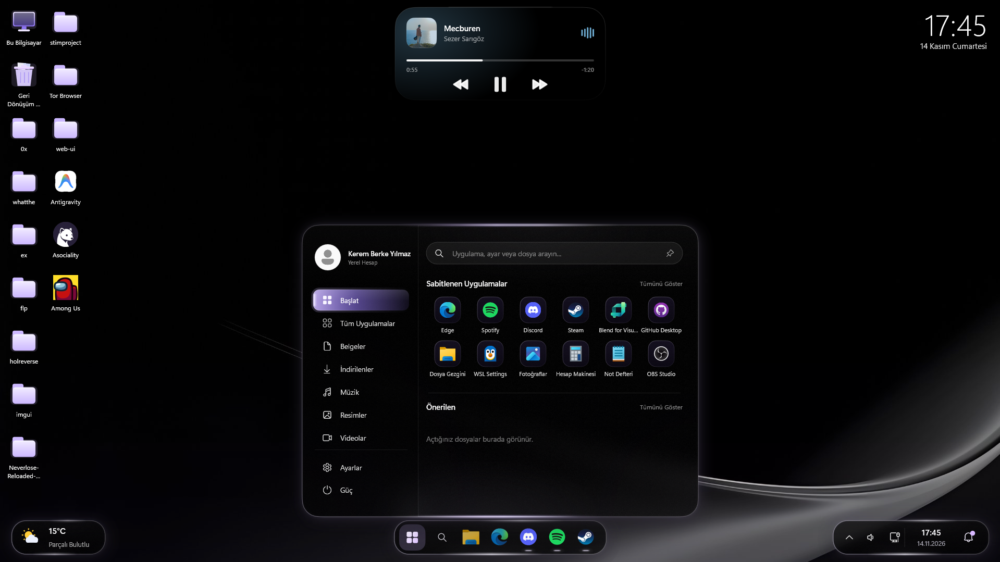

<p align="center"></p>

# Aether

**Tamamen yerel (native) bir Windows masaüstü kabuğu: Dynamic Island, görev çubuğu, Başlat menüsü, flyout'lar, masaüstü widget'ları, masaüstü, dosya yöneticisi, Geri Dönüşüm Kutusu ve gerçek bir installer. C++20, Direct2D ve DirectComposition ile yazıldı. Electron yok, web view yok.**

[English](README.md)



Aether, aynı görünümü paylaşan küçük programlardan oluşur. Windows'un yanında kullanabilir ya da **Explorer'ın yerine tamamen kabuk olarak** ayarlayabilirsin.

| Program | Ne yapar | Yönetici |
| :--- | :--- | :---: |
| `Aether.exe` | Dynamic Island, masaüstü widget'ları, Ayarlar Merkezi | hayır |
| `AetherBar.exe` | Görev çubuğu: dock, Başlat menüsü, tepsi, flyout'lar | evet (UAC) |
| `AetherDesktop.exe` | Masaüstü: duvar kağıdı, simgeler, Özelleştir penceresi | hayır |
| `AetherExplorer.exe` | Dosya yöneticisi | hayır |
| `AetherBin.exe` | Geri Dönüşüm Kutusu penceresi | hayır |
| `AetherShell.exe` | Oturum yöneticisi: diğerlerini başlatır ve izler, Alt+Tab, Win+R, Win+M ... | hayır |
| `AetherIntro.exe` | Oturum açılışında / ilk çalıştırmada açılış animasyonu | hayır |
| `AetherSetup.exe` | Tek dosyalık kurulum / kaldırma programı | evet |

## Özellikler

- **Dynamic Island**: boşta, müzik, sistem, ses ve bildirim durumları arasında yay fiziğiyle dönüşen hap; canlı medya kontrolü.
- **Görev çubuğu**: çok monitörlü dock, özel Başlat menüsü, gerçek sistem tepsisi, hızlı ayarlar, ağ merkezi (Wi-Fi, WPA2/WPA3), bildirim merkezi, hava durumu, takvim.
- **Masaüstü**: duvar kağıdı (doldur / sığdır / uzat / ortala / döşe, yumuşak geçiş) ve simgeler Aether cam stilinde; seçim, sürükle-bırak, yeniden adlandırma, kopyala/kes/yapıştır, gerçek Windows bağlam menüsü ("Diğer seçenekler"), `Ctrl` + tekerlek ile simge boyutu, `Win` + `D`.
- **Özelleştir** (masaüstüne sağ tık): canlı önizleme, duvar kağıdı ve slayt gösterisi, karartma, bulanıklık, simge boyutu, etiketler, parlama, vurgu rengi, saat. Widget'ların üstünde, kendi pencerelerinde açılır.
- **Widget'lar**: sistem performansı, ağ, saat, depolama, hava durumu, çalan müzik. Sağ tıkla gizlenir (tek tek veya hepsi).
- **Dosya yöneticisi ve Geri Dönüşüm Kutusu**: sıfırdan yazıldı; boştayken %0 CPU; arşivler (7-Zip / WinRAR / `tar.exe`), ağ konumları; Geri Dönüşüm'de geri yükleme, kalıcı silme, boşaltma.
- **Kabuk modu**: `explorer.exe` yerine kullanılır. AetherShell çubuğu, masaüstünü ve adayı başlatıp izler, oturum açılış başlangıç öğelerini çalıştırır, Alt+Tab / Win+Tab / Win+R / Win+M / Win+I / Win+D / Win+E sağlar. Acil durum: oturum açarken **Shift** basılı tut veya `%APPDATA%\Aether\use-explorer` oluştur. Ayrıntı: [tools/KABUK.md](tools/KABUK.md).
- **Intro ve installer**: `AetherIntro` her oturum açılışında kısa bir logo animasyonu gösterir (Esc / tık ile geçilir; kapatmak için `%APPDATA%\Aether\no-intro`). `AetherSetup` modern, Türkçe/İngilizce bir kurulum sihirbazıdır: konum, bileşenler, kısayollar, Windows ile başlatma, klasörleri Aether'de açma, **Windows kabuğunu değiştirme** (bu kullanıcı veya tüm kullanıcılar). Kaldırıcı *Uygulamalar* listesine kaydolur ve yaptığı her şeyi geri alır. `AetherSetup.exe /S` sessiz kurar.
- **Temalar**: Klasik (varsayılan), Violet, OLED Siyah, Şeffaf Cam, Okyanus, Zümrüt, Gül, Lavanta, Gün Batımı.

## Derleme

Gereksinimler: Windows 10 1903+ veya Windows 11, *C++ ile masaüstü geliştirme* iş yüküyle Visual Studio 2022+, CMake 3.20+.

```powershell
cmake -B build -G "Visual Studio 17 2022" -A x64
cmake --build build --config Release
```

`build\Release` içinde tüm programlar ve hepsini (duvar kağıtlarıyla) gömülü `payload.zip` olarak taşıyan `AetherSetup.exe` oluşur.

## Kurulum ve çalıştırma

`AetherSetup.exe`'yi çalıştır ve sayfaları takip et. Kurmadan denemek için derleme klasöründen `AetherShell.exe`'yi çalıştır (Explorer kabukken yalnızca kısayollar/geçiş penceresi devreye girer, gerisi Explorer'ın yanında açılır). Installer'sız elle kabuk kurulumu: `tools\install-shell.bat` / `tools\uninstall-shell.bat`.

## Dosyalar

| Yol | İçerik |
| :--- | :--- |
| `%APPDATA%\Aether\aether_config.json` | Ayarlar |
| `%APPDATA%\Aether\theme.txt`, `lang.txt` | Tüm programların paylaştığı tema ve dil |
| `%APPDATA%\Aether\desktop.cfg` | Masaüstü görünümü ve simge konumları |
| `%APPDATA%\Aether\shell-backup.json` | Önceki Windows kabuğu (kaldırma için) |
| `%APPDATA%\Aether\no-intro`, `use-explorer` | İsteğe bağlı anahtar dosyaları |

## Lisans

MIT, bkz. [LICENSE](LICENSE). Değişiklikler: [CHANGELOG.tr.md](CHANGELOG.tr.md).
